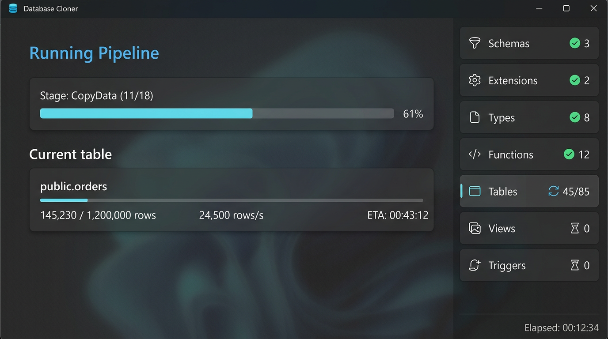

# Reading the Progress Panel

During a copy operation, DbClone shows real-time progress information.

## Progress Panel Layout

{ loading=lazy }

### 1. Current Phase

The top-level phase indicator shows where DbClone is in the overall workflow:

| Phase | Meaning |
|-------|---------|
| Starting... | Initializing the operation |
| Checking Connections | Testing source/destination connectivity |
| Checking Permissions | Verifying user privileges |
| Creating Backup Database | (Backup mode only) Creating the target database |
| Preparing Destination | Checking destination state |
| Cleaning Destination | Dropping existing objects |
| Waiting for Confirmation | Prompt asking whether to clean a non-empty destination |
| Running Pipeline | Executing copy stages |
| Complete | All done, successfully |
| Failed | Stopped due to errors |
| Cancelled | User cancelled the operation |

Once the pipeline is running, the phase label reflects the current stage — e.g. **Creating Schema**, **Copying Data**, **Creating Indexes**, **Creating Objects**, or **Validating**.

### 2. Stage Progress

Shows the current pipeline stage and overall percentage:

```
Stage: Copy Data (12/20)  ████████████░░░░░░  60%
```

### 3. Table Progress (during CopyData)

When copying data, you see per-table details:

- **Current table** — which table is being copied right now
- **Rows** — `145,230 / 1,200,000` rows completed
- **Speed** — `24,500 rows/s`
- **ETA** — estimated time remaining

### 4. Objects Panel

A horizontal strip of category chips along the top of the content area (right of the mode info bar) shows object categories with status indicators:

- ⏳ Pending
- 🔄 In progress
- ✅ Done
- Count of objects in each category

A chip turns ✅ Done when its stage finished, not when every object of that kind exists: a view the server
refused leaves the **View** chip green and is named in the warnings instead.

### 5. Elapsed Time

Total elapsed time since the operation started.

## Log Panel

Below the progress panel, a scrolling log shows detailed messages:

```
[14:30:01] [OK] CreateSchemas: 3 objects in 0.2s
[14:30:01] [OK] CreateExtensions: 2 objects in 0.5s
[14:30:02] [OK] CreateTypes: 8 objects in 0.3s
[14:30:15] [OK] CopyData: 45 objects in 12.8s
[14:30:15] [OK] CreateViews: 3 objects in 0.4s
[14:30:15] FAIL: reports.monthly: relation "public.events" does not exist
```

The last two lines belong together: **CreateViews** finished, and one of its views was not created. The
`[FAIL]` badge belongs to a stage that failed; a refused object is a `FAIL:` detail written at warning
severity, and the stage still reports `[OK]`.

!!! tip "Expand the log"
    Click the expand toggle (▼) to see the full log with per-object details.

## After Completion

When the operation finishes, the progress panel shows:

- **Total duration**
- **Objects copied** (tables, functions, views, etc.)
- **Warnings** (non-fatal issues — including objects the server refused, each named once)
- **Errors** (stages that failed)

The log is preserved until you start a new operation.
